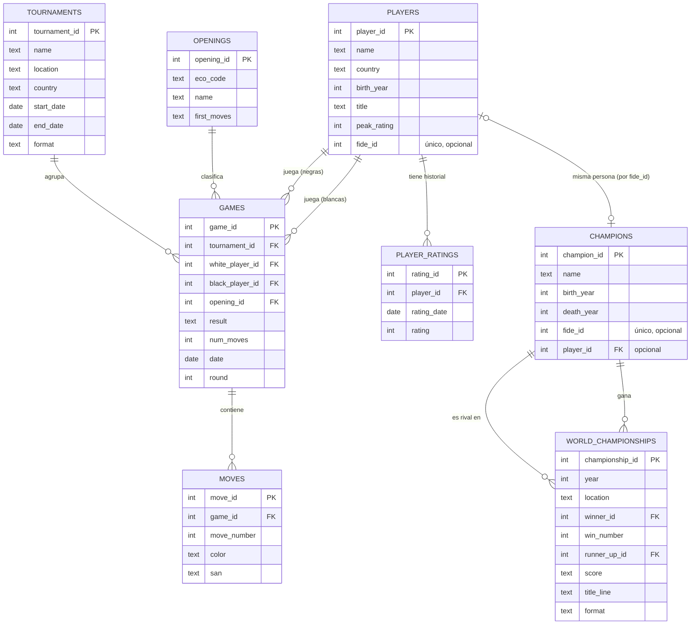

# Modelo de datos

Dominio: **partidas de ajedrez**. Base relacional en PostgreSQL (Supabase). Ocho tablas:
seis con datos sintéticos (semilla fija) y dos con datos reales de los campeonatos mundiales;
cumple el mínimo del enunciado (≥5 tablas, ≥15 registros por tabla) con holgura.

## Diagrama entidad-relación

## Notas de diseño

- **`games`** es la tabla central: referencia jugadores (blancas y negras), apertura y torneo.
- **`moves`** guarda **una fila por media jugada (ply)** con un índice en `game_id` para que
  reconstruir una partida sea instantáneo. Ver [ADR 0003](../decisions/0003-moves-por-ply.md).
- **`player_ratings`** permite consultas de evolución temporal (series de tiempo).
- **`champions` y `world_championships`** son **datos reales** (no sintéticos): los campeonatos
  salen de `data/pdfs/list-of-world-chess-championships.pdf` y los años de nacimiento y muerte,
  de Wikidata. `world_championships` referencia a
  `champions` dos veces (`winner_id`, `runner_up_id`); un mismo año puede tener varias
  filas en el cisma 1993-2006 (`title_line`: `main`, `classical`, `fide_split`).
- **`champions.player_id` es un vínculo opcional con `players`**, resuelto por **`fide_id`** (el
  FIDE ID, presente en ambas tablas) y no por nombre: los nombres son texto libre y no hay un
  estándar (la FIDE llama "Gukesh D" a quien el PDF llama "Gukesh Dommaraju"). Cada FIDE ID se
  tomó de Wikidata y se verificó contra la ficha en `ratings.fide.com`; los que no se pudieron
  verificar quedan en `NULL`. Se completa para 8 de 44 personas; los campeones históricos
  anteriores al sistema de ratings no tienen FIDE ID. No se inventaron jugadores sintéticos para
  los campeones históricos, que ensuciarían los datos de `games`. Tampoco se guarda el país: Wikidata trae
  varias nacionalidades históricas por persona y elegir una sería un juicio, no un dato.
- El detalle campo por campo, con tipos y valores válidos, está en el
  [diccionario de datos](data-dictionary.md).
